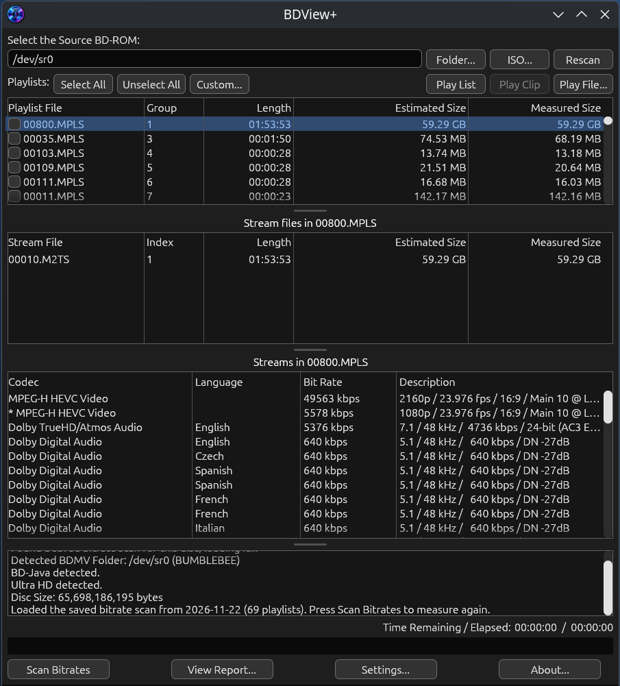
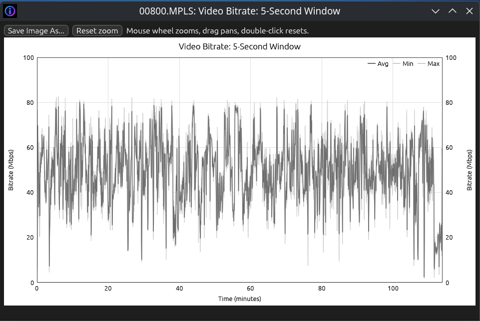
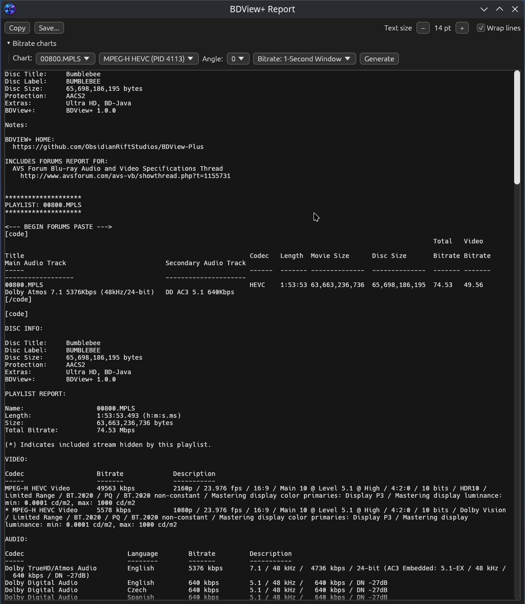
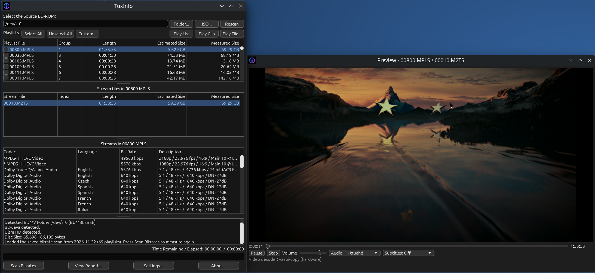

# BDView+


**Blu-ray and Ultra HD disc analyzer for Linux.**

By [Obsidian Rift Studios](https://github.com/ObsidianRiftStudios)

BDView+ shows you what is really on a Blu-ray or 4K UHD disc: every playlist, the video, audio and subtitle
streams inside it, and the measured bit rate of each one. It can draw bit rate charts, produce a text report
you can copy or save, and play a preview of any playlist or clip. It works on a disc in a drive, an ISO image,
or a folder, and it comes with both a graphical window and a command-line mode.

BDView+ is written in Rust and is based on [BDInfo](https://github.com/UniqProject/BDInfo).



## Features

- **Playlists and streams.** See every playlist on the disc with its length and size, and the video, audio and
  subtitle streams in each one, with language, codec and format details (HDR10, Dolby Vision, Atmos, DTS:X and more).
- **Measured bit rates.** Scan the disc to find the real bit rate of every stream, not just the one the disc claims.
- **Bit rate charts.** Graph the bit rate over time, frame sizes, and frame types for any stream. Zoom, pan and
  save the chart as a PNG.
- **Reports.** Open a full report in its own window, then copy it or save it to a text file.
- **Custom playlists.** Pick clips from a disc and build your own playlist to scan and chart.
- **Saved scans.** A finished bit rate scan is saved, so the next time you open the same disc the results load
  right away instead of scanning again.
- **Preview.** Play a playlist, a single clip, or any video file in a built-in player with seeking, volume, and
  audio and subtitle selection.
- **Encrypted discs.** Reads protected discs through libbluray, with optional MakeMKV support.







## Installing

Download the latest `.deb` from the [Releases](https://github.com/ObsidianRiftStudios/BDView-Plus/releases) page and install it:

```
sudo apt install ./bdview-plus_1.0.0_amd64.deb
```

BDView+ then appears in your application menu, or you can start it with `bdview-plus --gui`.

To read discs and play previews you also need:

```
sudo apt install libbluray2 libmpv2
```

For protected discs, install [MakeMKV](https://www.makemkv.com/) as well. BDView+ will use its decryption library
automatically when it finds it.

## Using the program

1. Start BDView+. The source box is filled in with your optical drive. You can also click **Folder...** or **ISO...**,
   or drag a disc folder or ISO onto the window.
2. The playlists on the disc are listed straight away. Click one to see its stream files and streams below it.
3. Tick the playlists you want to measure and click **Scan Bitrates**. A full disc can take a while to scan.
4. When the scan finishes, click **View Report...** for the text report, or open the bit rate charts from the report.
5. Use **Play List**, **Play Clip** or **Play File...** to preview video.

Everything can be resized, and the text size can be changed in **Settings...**.

## Command line

BDView+ can also run without a window and print a report, which is handy for scripts or for working over SSH.

```
bdview-plus <disc> [options]
```

`<disc>` can be a disc folder (the `BDMV` folder or the folder above it), an ISO image, or a drive such as `/dev/sr0`.
Run `bdview-plus` with no arguments to open the window instead.

| Option | What it does |
| --- | --- |
| `-l`, `--list` | List the playlists on the disc and exit |
| `-p`, `--playlists A,B` | Report only these playlists, for example `-p 00800,00801` |
| `-o`, `--output PATH` | Write the report to a file, or into a folder |
| `--all` | Include short (under 20 seconds) and looping playlists |
| `--sort` | Put the longest playlists first |
| `--quick` | Identify the streams only and skip the bit rate scan |
| `--no-diag` | Leave out the stream diagnostics table |
| `--extended` | Wait for HDR metadata before finishing HEVC streams |
| `--no-bluray` | Read stream files directly instead of through libbluray (unencrypted data only) |
| `-q`, `--quiet` | Hide progress output |
| `--gui [disc]` | Open the window, optionally with a disc already loaded |
| `-h`, `--help` | Show the help text |

### Examples

```
bdview-plus /dev/sr0 -l                      # list the playlists on the disc in the drive
bdview-plus ~/rips/MyMovie.iso               # full report for all main playlists
bdview-plus ~/rips/MyMovie.iso --quick       # fast scan: streams only, no bit rates
bdview-plus /mnt/bd -p 00800 -o report.txt   # report for one playlist, saved to a file
bdview-plus ~/rips/MyMovie.iso --gui         # open the window with this disc loaded
```

Without `-o`, the report is printed to the terminal.

## Building from source

You need a recent Rust toolchain.

```
cargo build --release
./target/release/bdview-plus
```

To make a `.deb` package:

```
packaging/build-deb.sh
```

The finished package is written to `target/`.

## Support

Found a bug or have an idea? Open an [issue](https://github.com/ObsidianRiftStudios/BDView-Plus/issues) on GitHub, or email
[support@obsidianrift.net](mailto:support@obsidianrift.net).

## Good to know

- BDView+ reads Blu-ray and Ultra HD discs, from a drive, an ISO image or a folder. Blu-ray 3D is not supported.
- Encrypted discs need libbluray, and MakeMKV's library for the protected ones. If libbluray is missing, only
  already-decrypted files can be read.
- The preview needs `libmpv2`. The rest of the program works without it.

## License and credits

BDView+ is released by Obsidian Rift Studios under the LGPL-2.1-or-later license (see `LICENSE`).

It is based on BDInfo by Cinema Squid, continued by the UniqProject developers, which is also LGPL-2.1.
Disc reading uses libbluray and MakeMKV's libmmbd, the preview uses libmpv, and the window is drawn with egui.
